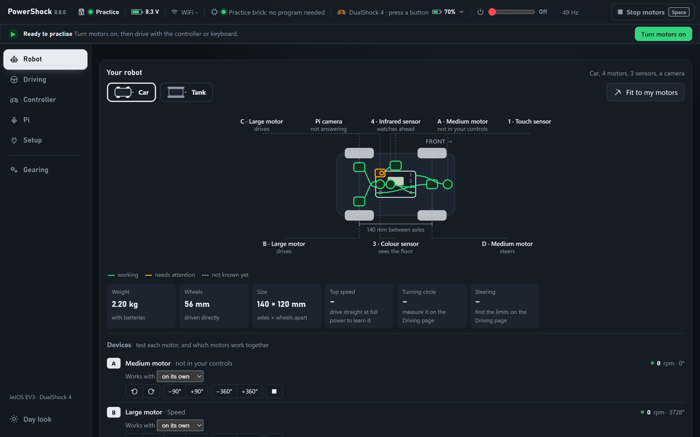
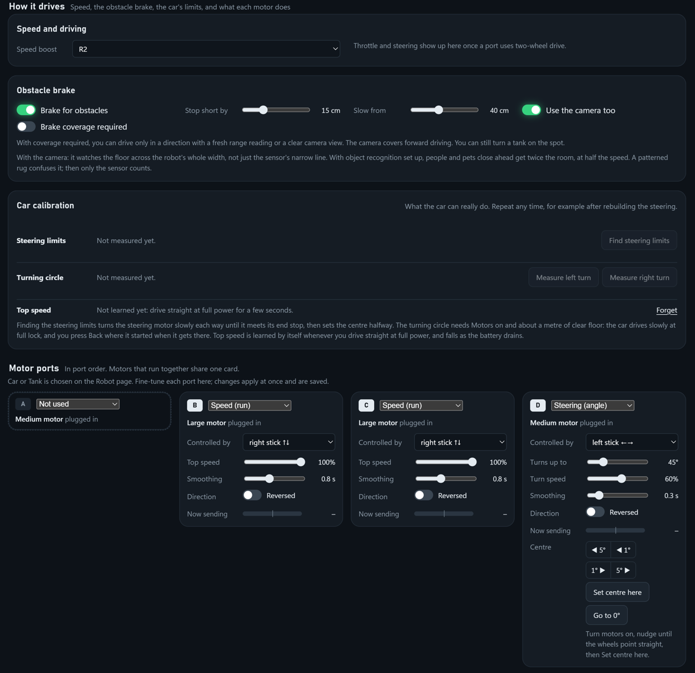
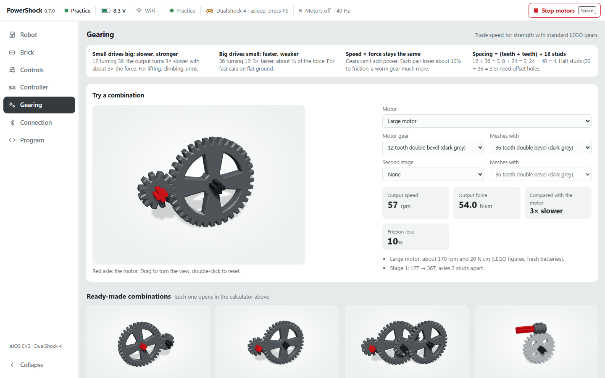
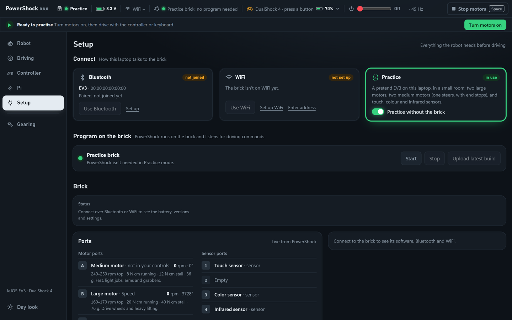

# PowerShock

Drive a LEGO Mindstorms EV3 running leJOS with a PS4 DualShock 4 controller, from a local web console on your Windows laptop.



- **Plug and drive:** pair the controller with Windows, connect the brick over WiFi or Bluetooth, and drive.
- **Your robot, your controls:** choose which stick drives which motor. Each port gets two-wheel drive, speed, or a steering angle, with smoothing and a steering centre.
- **See what the brick sees:** the brick, its motors and sensors in 3D, live. Each motor can be tested on its own.
- **A live map:** the robot's infrared, ultrasonic, colour and gyro sensors build a 3D map of the room as you drive.
- **A camera, if you have a Raspberry Pi:** drive from the robot's point of view. Optionally, the laptop recognises people, cups, balls, pets and more in the video, live.
- **Built for a safe first drive:** the motors stop within half a second if anything goes quiet. They never restart by themselves after a dropped link.
- **No hardware?** **Practice** mode runs a pretend brick on the laptop.

Current version: **0.7.0** (see [CHANGELOG.md](CHANGELOG.md)).

## How it works

```
DualShock 4 ──Bluetooth/USB──▶ Windows laptop ──WiFi or Bluetooth──▶ EV3 brick
                               browser page + console (Python)        powershock-wifi.jar (Java 7)
```

- **The browser page** reads the controller through the Gamepad API.
- **The console** (`pc/ev3_console.py`, Python standard library only) applies your controls 50 times a second and sends a command line for each motor port to the brick.
- **The brick program** drives the motors and reports battery, ports and motor angles back 4 times a second.

| | A. Through the laptop (recommended) | B. Controller straight to the brick (experimental) |
|---|---|---|
| Path | DS4 → Windows → console → WiFi/Bluetooth → EV3 | DS4 → EV3 over Bluetooth |
| EV3 program | `powershock-wifi.jar` (`DS4Receiver`) | `powershock-bt.jar` (`DS4Drive`) |
| Status | works; tested with a real DS4 and EV3 | untested; many controllers refuse an unpaired host |

## You need

- **Windows 10 or 11** with Bluetooth. The console uses Windows' built-in OpenSSH client.
- **Python 3.9 or newer.** Nothing to install. Optional object recognition needs Python 3.10+ and three packages (see below).
- **A JDK, 17 or newer,** to build the brick program. It is found in `%USERPROFILE%\.jdks`, `JAVA_HOME` or on `PATH`.
- **A LEGO EV3 with a leJOS 0.9.1-beta SD card.** For WiFi you also need a supported USB dongle, e.g. Netgear WNA1100.
- **A DualShock 4**, and Chrome or Edge.

## Quick start

1. **Get three jars from your own leJOS SD card.**
   - The build needs `ev3classes.jar`, `jna.jar` and the Java 7 class library `rt7.jar`. They aren't in this repository: Oracle's Java runtime may not be redistributed, and leJOS and JNA have their own licences.
   - Copy the SD card's files to a folder that holds `lejosimage.bz2` and `ejre-7u60-*.tar.gz`, then run:
     ```powershell
     python pc\tools\extract_libs.py <that folder>
     ```
2. **Build the brick program:**
   ```powershell
   .\build.ps1
   ```
3. **Start the console:**
   ```powershell
   python pc\ev3_console.py
   ```
   It opens http://127.0.0.1:8765.
4. **Setup page, Connect:** connect the brick.
   - **Bluetooth:** pair the EV3 in Windows, then Devices and Printers → right-click EV3 → *Connect using* → *Access point*.
   - **WiFi:** connect over Bluetooth first, then **Set up WiFi**.
5. **Setup page, Program on the brick:** **Upload latest build**, then **Start**. Java takes about 30 seconds to start on the EV3.
6. **Controller page:** pair the DualShock 4 with Windows, then press any button with the console open.
7. **Driving page:** pick **Car**, **Tank** or **Fit to my motors**.
8. **Robot page:** **Turn motors on**, and drive. **Stop motors** (or Space, Esc, ✕ or Options on the controller) stops everything.

The brick's battery shows top-left on the leJOS screen. A blinking number means it's low: charge first.

## The console

The menu has the pages you use while driving, then the setup and a tool:

- **Robot:** drive, with the controller and the brick in 3D, live, the camera, and a test panel for each motor.
- **Map:** what the sensors have found.
- **Driving:** which stick drives which motor.
- **Controller:** the DualShock: pairing, battery, sticks.
- **Setup:** connect the brick and the camera, put PowerShock on the brick, and check the brick.
- **Gearing:** a gear calculator.

It looks like a car's instrument cluster at night: a dark cabin, with the 3D brick, controller, map and camera in lit wells, and the EV3's own status-light colours for what's live. **Day look**, at the bottom of the menu, switches to a light version, and the console remembers your choice.

### Camera

Give the robot eyes: a Raspberry Pi with a camera rides on it and streams live video. The Robot page shows the video when you switch its 3D view from **Brick** to **Camera**, so you can drive from the robot's point of view.

- **On the Pi:** run `pi/powershock_cam.py`. It uses only the standard library and works with any Raspberry Pi OS camera tool.
- **In the console:** **Setup → Camera** takes the Pi's address and the access key it prints.
- **Setup guide:** [docs/CAMERA.md](docs/CAMERA.md) covers the SD card, connecting the camera, the access key and starting at boot.

### Object recognition (optional)

The laptop can recognise 80 kinds of everyday thing in the camera's video, and draw a box and a name around each, about 10 times a second. Turn it on with the **Recognise objects** button on the Camera view, or press **R**.

It's the one part of PowerShock that needs more than the standard library. Set it up once, with Python 3.10 or newer:

```powershell
python -m pip install -r pc\requirements-vision.txt
python pc\tools\get_model.py
```

The second command downloads the YOLOX-nano model (3.7 MB, Apache-2.0) and checks its checksum. Everything runs on the laptop. The full guide is [docs/VISION.md](docs/VISION.md).


### Map

A live 3D map of what the robot's sensors find while it drives, seen from behind the robot or from above.

- **Infrared or ultrasonic sensor,** facing forward: draws walls and obstacles.
- **Colour sensor,** pointing at the floor: paints the floor's colours.
- **Gyro sensor,** if you have one: keeps the heading accurate.

Plug a sensor into any sensor port; it's picked up within a few seconds. The robot's position is worked out from its wheels, so set **Robot size** to match your robot: wheel diameter, wheel spacing, axle spacing, and where the sensors sit. In Practice mode, the pretend robot drives around a small room with two boxes, blue tape and a red mat.

What to expect from the sensors that come with EV3 sets:

- **Infrared:** reads up to about 70 cm, with a wide beam.
- **Ultrasonic:** up to about 1.5 m, with a narrower beam.
- **Drift:** each wheel slip adds an error, so the map drifts. **Clear map** starts again from where the robot is.

**Seen by the camera:** with the Raspberry Pi camera and [object recognition](#object-recognition-optional) set up, turn on **Recognise things while this page is open**. What the camera recognises (people, chairs, cups, pets…) appears on the map as a labelled marker where it stands, and stays there as the robot drives on.
- **Direction:** from where it is across the picture.
- **Distance:** from where it meets the floor in the picture, so set the camera's height and tilt under **Robot size**. Straight ahead, the infrared sensor's distance is used instead.
- **Fewer wrong guesses:** a thing has to be seen twice before it's drawn. Something that should be in view but isn't seen any more (a person who walked off) is taken off the map.
- **Recognition on the Robot page's Camera view** puts things on the map too.

The map also draws the obstacle brake's lines in front of the robot: where it stops, and where it starts slowing. They light up while it brakes.

**The instrument panel** in the corner of the map shows, live while the robot is linked:
- **Speed** in cm/s, from the wheels, and whether it's going forward or backward. An arrow on the floor shows where the robot will be in a second.
- **Heading:** a compass needle and how far it has turned from where the map started, and how fast it's turning.
- **The autopilot:** what it's doing (clear, slowing, stopped, careful), how much speed you ask for against how much it allows, and why: the nearest thing ahead and which sensor saw it.
- **Its last decisions,** such as "Slowed: 32 cm ahead, camera", with how long ago. Only changes to the driving are listed, not everything it sees. For now, the autopilot is the obstacle brake.

**The floor the camera sees:** while the console is linked to the robot and **Use the camera too** is on (Driving page), the camera watches the floor. It needs only Pillow, not the recognition model.
- **On the map:** a green fan shows where the floor is free, in about 30 directions at once. Where something stands on the floor, the fan ends in a red edge, and the map marks it, as the infrared sensor does. The camera counts half as much as the sensor.
- **The camera on the robot:** drawn where it sits, with lines to the corners of the floor it can see. Change its height or tilt under **Robot size**, and the lines move.
- **Where the camera sits, worked out:** not sure how high the camera is, or how far it looks down? Stand the robot with its infrared sensor facing a box or wall, and stop at a few distances between 20 and 60 cm, holding still for a moment at each. The map compares where the camera sees the floor end with what the sensor measures, and suggests a tilt and height. **Use these** saves them.
- **How it works:** it learns what the floor looks like just in front of the robot, then follows each column of the picture up until it stops looking like floor. Shadows still count as floor.
- **Weak spots:** a patterned rug, things the same colour as the floor, white skirting on a white floor. The Map page says when the floor is too patterned to judge, and the brake then uses only the sensor.
- **In Practice,** a pretend camera sees the practice room.


### Driving

Which stick drives which motor. Pick a starting layout, then fine-tune each motor port.

- **Steering ports** get a **Centre** control: nudge the wheels straight, then **Set centre here**.
- **Changes** apply while you drive and are saved.
- **Obstacle brake** (on unless you switch it off): with an infrared or ultrasonic sensor facing ahead, the robot slows down when something is closer than 40 cm and stops 15 cm short. Both distances can be changed.
  - **Only driving towards the obstacle is braked.** You can always back away, or turn on the spot.
  - **It runs on the laptop,** in the same loop that sends the commands, so no brick upload is needed. The sensor reading is up to a quarter of a second old, so the brake allows for how far the robot has driven since.
  - **No reading for 0.8 s:** it stops driving towards whatever might be there.
  - **While it brakes,** the status bar, the camera's full-screen view and the Map page say so.
  - **Pushing something on purpose,** like a ball: switch the brake off.
  - **Use the camera too** (on by default, with a camera set up): the camera watches the floor across the robot's whole width, not just the sensor's narrow line. The nearer of the two counts. It works without an infrared sensor too, but then only for driving forward.
  - **People and pets:** with [object recognition](#object-recognition-optional) set up, a person, cat, dog or bird close ahead makes the brake keep twice the distance, at half the speed.
  - **If the camera stops** while it's the only thing watching, the brake stops the robot, as it does without a sensor reading.



### Controller

The Controller page covers:

- **Pairing:** steps for Bluetooth and USB.
- **Wake-up help:** what to do when the controller falls asleep.
- **Controller details:** battery, model and firmware, read through Windows.
- **Stick calibration:**
  - **Calibrate** learns the sticks' rest position and full range.
  - **Dead zone** and **Response** tune the feel.


### Gearing

Work out speed and force with standard LEGO gears, shown in 3D.



### Setup

Everything the robot needs before driving, in the order you need it:

1. **Connect:** Bluetooth, WiFi, **Practice**, and the camera.
   - **Set up WiFi** puts the brick on your network. Your password is turned into a WPA key on the laptop, so only the key reaches the brick.
   - **Enter address** connects to the brick by its IP address.
2. **Program on the brick:** is PowerShock on the brick, and is it this version? **Upload latest build**, **Start**, **Stop**.
3. **Brick:** battery, memory, versions, and what's plugged into each port, with LEGO's specs.



## Safety and security

- **The motors stop:**
  - within 0.5 s if commands stop arriving
  - at once if the connection drops
  - when the controller disconnects, or the console page is closed or loses focus

  A dropped link also switches **Motors on** off.
- **The obstacle brake** only ever takes speed away. It's a help, not a guarantee. The infrared sensor misses thin chair legs and dark or shiny things, and sees only straight ahead. The camera misses things the colour of the floor, and can't see what's right under its nose. Drive slowly near people and pets.
- **The console** listens only on `127.0.0.1` and answers only its own page. It refuses requests from other machines, from other websites open in your browser, and with a foreign `Host` name (DNS rebinding).
- **PowerShock on the brick** listens on TCP port 5000 with no password: anyone on the same network could connect and move the motors.
  - Commands are range-limited, and input size is capped.
  - The leJOS image itself already lets anyone on the network log in over SSH as `root` without a password.
  - Use the brick on networks you trust, or over Bluetooth.
- **Your WiFi password** is turned into a WPA key on the laptop, as `wpa_passphrase` does. The password is never stored, logged or sent.

## Versioning

PowerShock uses [Semantic Versioning](https://semver.org/), with one version for the whole app.

- **Where it lives:** in [`VERSION`](VERSION).
- **On the brick:** `build.ps1` stamps it into the brick programs, and the brick reports it when the console connects.
- **In the console:** it shows next to the name. The Setup page warns when the brick runs an older version.

Changes are listed in [CHANGELOG.md](CHANGELOG.md), which also describes how to make a release. How the project grew, and what worked and what didn't along the way, is in [docs/JOURNEY.md](docs/JOURNEY.md).

## B. Controller straight to the brick (experimental)

1. **Put the controller's address in the code.**
   - Find the **controller's** Bluetooth address (not the EV3's): Device Manager → Bluetooth → *Wireless Controller* → Properties → Details → *Bluetooth device address*.
   - Put it in `DS4_MAC` in `ev3/src/powershock/DS4Drive.java`.
2. **Remove the DS4 from Windows**, or it connects to the laptop instead.
3. **Turn Bluetooth on** in the leJOS menu.
4. **Upload and start:** upload as above, run *powershock-bt.jar*, and hold **Share + PS**.
5. **Read the screen:** it shows `Connected!` or an error number.
   - `errno 110/111/112/113`: the controller refused the unpaired host. Use A.
   - `16` or `98`: leJOS's Bluetooth service holds the channels.

## Development

```powershell
cd pc; python -m unittest      # all tests, no hardware needed
.\build.ps1                    # brick programs into out\
.\build.ps1 -Ev3Ip <address>   # build and upload
```

Read [AGENTS.md](AGENTS.md) before contributing, whether you are a person or a coding agent. It covers project rules, privacy checks, tests and the release steps.

```
ev3/src/powershock/      brick side (Java 7, leJOS 0.9.1)
  DS4Receiver.java       A: TCP server on port 5000; port commands (P), motor tests (M), version (V) and status (T) back
  Drive.java             claims motors as they're plugged in; speed / angle / test commands; limits
  Sensors.java           reads IR, ultrasonic, colour and gyro sensors for the map, on its own thread
  PortWatch.java         what's plugged into each port, from the kernel's connection manager
  Version.java           the version stamped in by build.ps1
  PortProbe.java         one-off port check (JSON)
  DS4.java, DS4State.java, DS4Drive.java   B: L2CAP driver via JNA
  Mixer.java             tank mixing for the old "left right aux" lines
pc/
  ev3_console.py         the console: web server, 50 Hz sender, practice brick
  console/               the page (index.html), 3D controller (ds4model.js), 3D gears (gears3d.js),
                         3D map (map3d.js), three.js
  mapping.py             controls mapping, stick calibration and response curve
  worldmap.py            the live map: position from the wheels, occupancy grid from the sensors
  ev3_brick.py           talks to the brick: SSH, upload, start/stop, WiFi setup, port check
  ds4_hid.py             DualShock battery, model and firmware through Windows' HID API
  version.py             reads VERSION
  tools/BrickMenu.java   leJOS menu over RMI (versions, battery)
  tools/extract_libs.py  copies the three jars from your SD card
  camera.py              the robot camera: Pi address and key, status, video relay
  vision.py              object recognition on the camera's video (optional; numpy, onnxruntime, Pillow)
  requirements-vision.txt   the packages object recognition needs
  tools/get_model.py     downloads and checks the recognition model into pc/models/ (not in git)
pi/
  powershock_cam.py      runs on a Raspberry Pi: streams its camera as MJPEG (needs the access key)
  test_*.py              tests
  ds4_client.py, ds4_mix.py, fake_ev3.py   older pygame client and its stand-in brick
build.ps1                compile for Java 7, stamp the version, package, upload
docs/TROUBLESHOOTING.md  battery, WiFi, Bluetooth PAN, SSH, port detection, DualShock
docs/CAMERA.md           setting up the Raspberry Pi camera
docs/VISION.md           setting up object recognition: packages, model download, what to expect
docs/JOURNEY.md          how the project came about: stages, what worked and what didn't
```

Not done yet: light bar and rumble; pairing for variant B, so it reconnects with just the PS button.

## Licence

No licence has been chosen yet, so all rights are reserved for now. Third-party code keeps its own licence: three.js is MIT (see `pc/console/vendor/three/LICENSE`). The optional recognition model, YOLOX-nano, is Apache-2.0 and isn't included: `pc/tools/get_model.py` downloads it from its source.
