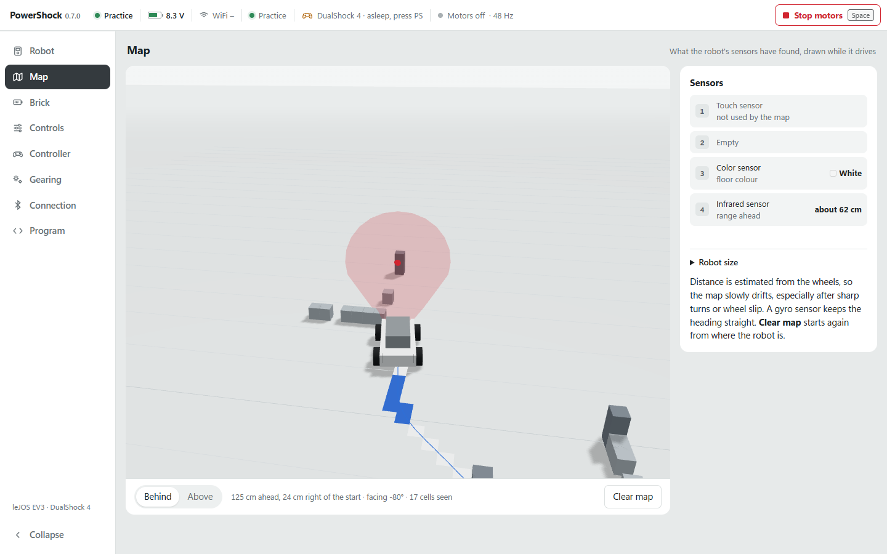
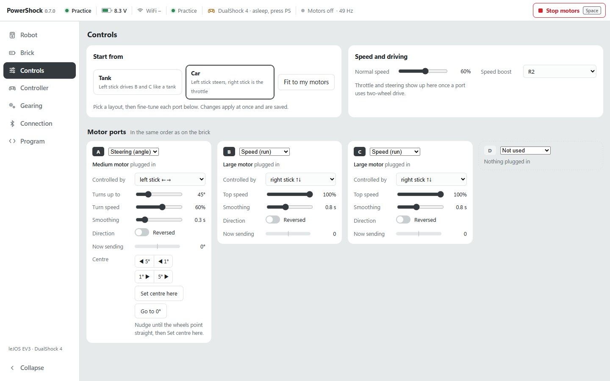
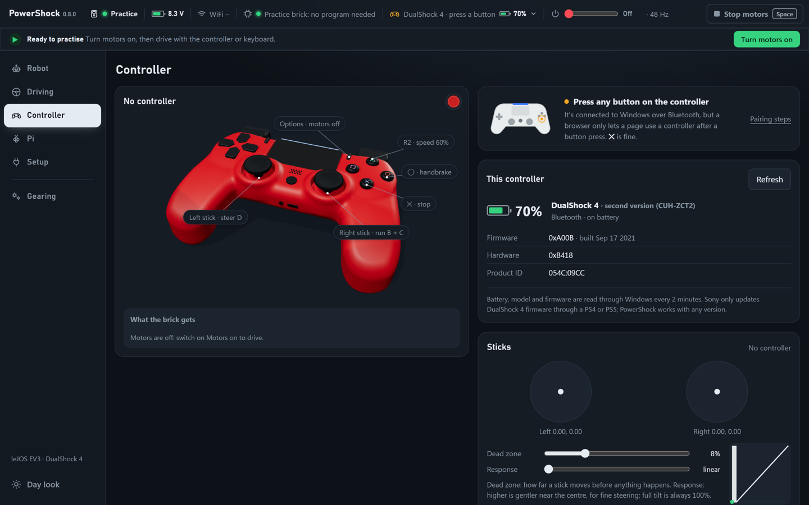
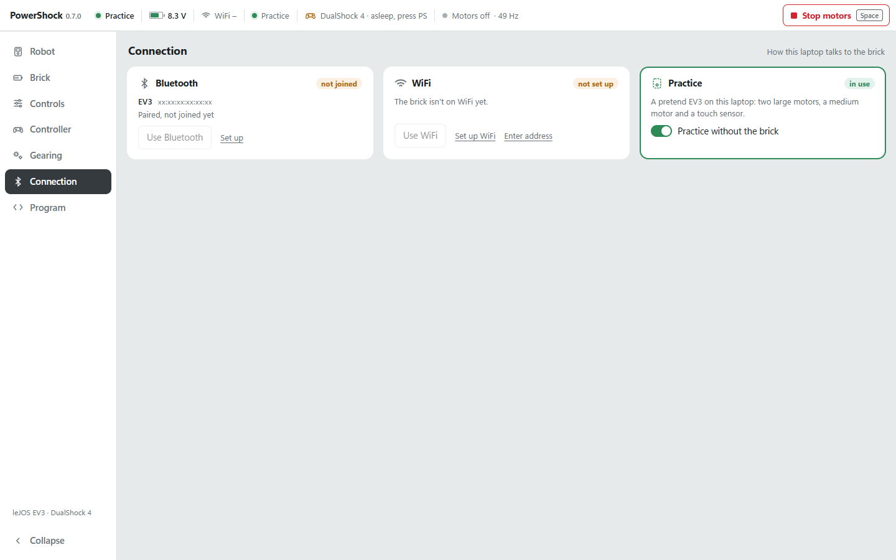

# PowerShock

Drive a LEGO Mindstorms EV3 running leJOS with a PS4 DualShock 4 controller, from a local web console on your Windows laptop.


- **Plug and drive:** pair the controller with Windows, connect the brick over WiFi or Bluetooth, and drive.
- **Your robot, your controls:** choose which stick drives which motor. Each port gets two-wheel drive, speed, or a steering angle, with smoothing and a steering centre.
- **See what the brick sees:** the brick, its motors and sensors in 3D, live. Each motor can be tested on its own.
- **A live map:** the robot's infrared, ultrasonic, colour and gyro sensors build a 3D map of the room as you drive.
- **A camera, if you have a Raspberry Pi:** drive from the robot's point of view.
- **Built for a safe first drive:** the motors stop within half a second if anything goes quiet. They never restart by themselves after a dropped link.
- **No hardware?** **Practice** mode runs a pretend brick on the laptop.

Current version: **0.7.0** (see [CHANGELOG.md](CHANGELOG.md)).

## How it works

```
DualShock 4 ──Bluetooth/USB──▶ Windows laptop ──WiFi or Bluetooth──▶ EV3 brick
                               browser page + console (Python)        powershock-wifi.jar (Java 7)
```

- **The browser page** reads the controller through the Gamepad API.
- **The console** (`pc/ev3_console.py`, Python standard library only) applies your controls 50 times a second and sends a command line for each motor port to the brick.
- **The brick program** drives the motors and reports battery, ports and motor angles back 4 times a second.

| | A. Through the laptop (recommended) | B. Controller straight to the brick (experimental) |
|---|---|---|
| Path | DS4 → Windows → console → WiFi/Bluetooth → EV3 | DS4 → EV3 over Bluetooth |
| EV3 program | `powershock-wifi.jar` (`DS4Receiver`) | `powershock-bt.jar` (`DS4Drive`) |
| Status | works; tested with a real DS4 and EV3 | untested; many controllers refuse an unpaired host |

## You need

- **Windows 10 or 11** with Bluetooth. The console uses Windows' built-in OpenSSH client.
- **Python 3.9 or newer.** Nothing to install.
- **A JDK, 17 or newer,** to build the brick program. It is found in `%USERPROFILE%\.jdks`, `JAVA_HOME` or on `PATH`.
- **A LEGO EV3 with a leJOS 0.9.1-beta SD card.** For WiFi you also need a supported USB dongle, e.g. Netgear WNA1100.
- **A DualShock 4**, and Chrome or Edge.

## Quick start

1. **Get three jars from your own leJOS SD card.**
   - The build needs `ev3classes.jar`, `jna.jar` and the Java 7 class library `rt7.jar`. They aren't in this repository: Oracle's Java runtime may not be redistributed, and leJOS and JNA have their own licences.
   - Copy the SD card's files to a folder that holds `lejosimage.bz2` and `ejre-7u60-*.tar.gz`, then run:
     ```powershell
     python pc\tools\extract_libs.py <that folder>
     ```
2. **Build the brick program:**
   ```powershell
   .\build.ps1
   ```
3. **Start the console:**
   ```powershell
   python pc\ev3_console.py
   ```
   It opens http://127.0.0.1:8765.
4. **Connect the brick** on the **Connection** page.
   - **Bluetooth:** pair the EV3 in Windows, then Devices and Printers → right-click EV3 → *Connect using* → *Access point*.
   - **WiFi:** connect over Bluetooth first, then **Set up WiFi**.
5. **Program page:** **Upload latest build**, then **Start**. Java takes about 30 seconds to start on the EV3.
6. **Controller page:** pair the DualShock 4 with Windows, then press any button with the console open.
7. **Controls page:** pick **Car**, **Tank** or **Fit to my motors**.
8. **Robot page:** **Turn motors on**, and drive. **Stop motors** (or Space, Esc, ✕ or Options on the controller) stops everything.

The brick's battery shows top-left on the leJOS screen. A blinking number means it's low: charge first.

## The console

### Camera

Give the robot eyes: a Raspberry Pi with a camera rides on it and streams live video. The Robot page shows the video when you switch its 3D view from **Brick** to **Camera**, so you can drive from the robot's point of view.

- **On the Pi:** run `pi/powershock_cam.py`. It uses only the standard library and works with any Raspberry Pi OS camera tool.
- **In the console:** **Connection → Camera** takes the Pi's address and the access key it prints.
- **Setup guide:** [docs/CAMERA.md](docs/CAMERA.md) covers the SD card, connecting the camera, the access key and starting at boot.

### Map

A live 3D map of what the robot's sensors find while it drives, seen from behind the robot or from above.

- **Infrared or ultrasonic sensor,** facing forward: draws walls and obstacles.
- **Colour sensor,** pointing at the floor: paints the floor's colours.
- **Gyro sensor,** if you have one: keeps the heading accurate.

Plug a sensor into any sensor port; it's picked up within a few seconds. The robot's position is worked out from its wheels, so set **Robot size** to match your robot: wheel diameter, wheel spacing, axle spacing, and where the sensors sit. In Practice mode, the pretend robot drives around a small room with two boxes, blue tape and a red mat.

What to expect from the sensors that come with EV3 sets:

- **Infrared:** reads up to about 70 cm, with a wide beam.
- **Ultrasonic:** up to about 1.5 m, with a narrower beam.
- **Drift:** each wheel slip adds an error, so the map drifts. **Clear map** starts again from where the robot is.



### Controls

Pick a starting layout, then fine-tune each motor port.

- **Steering ports** get a **Centre** control: nudge the wheels straight, then **Set centre here**.
- **Changes** apply while you drive and are saved.



### Controller

The Controller page covers:

- **Pairing:** steps for Bluetooth and USB.
- **Wake-up help:** what to do when the controller falls asleep.
- **Controller details:** battery, model and firmware, read through Windows.
- **Stick calibration:**
  - **Calibrate** learns the sticks' rest position and full range.
  - **Dead zone** and **Response** tune the feel.



### Gearing

Work out speed and force with standard LEGO gears, shown in 3D.


### Connection

Bluetooth, WiFi or **Practice**.

- **Set up WiFi** puts the brick on your network. Your password is turned into a WPA key on the laptop, so only the key reaches the brick.
- **Enter address** connects to the brick by its IP address.



### Other pages

- **Brick:** battery, memory, versions, and what's plugged into each port.
- **Robot:** the controller and the brick in 3D, live, with a test panel for each motor.
- **Program:** is PowerShock on the brick, and is it this version? **Upload latest build**, **Start**, **Stop**.

## Safety and security

- **The motors stop:**
  - within 0.5 s if commands stop arriving
  - at once if the connection drops
  - when the controller disconnects, or the console page is closed or loses focus

  A dropped link also switches **Motors on** off.
- **The console** listens only on `127.0.0.1` and answers only its own page. It refuses requests from other machines, from other websites open in your browser, and with a foreign `Host` name (DNS rebinding).
- **PowerShock on the brick** listens on TCP port 5000 with no password: anyone on the same network could connect and move the motors.
  - Commands are range-limited, and input size is capped.
  - The leJOS image itself already lets anyone on the network log in over SSH as `root` without a password.
  - Use the brick on networks you trust, or over Bluetooth.
- **Your WiFi password** is turned into a WPA key on the laptop, as `wpa_passphrase` does. The password is never stored, logged or sent.

## Versioning

PowerShock uses [Semantic Versioning](https://semver.org/), with one version for the whole app.

- **Where it lives:** in [`VERSION`](VERSION).
- **On the brick:** `build.ps1` stamps it into the brick programs, and the brick reports it when the console connects.
- **In the console:** it shows next to the name. The Program page warns when the brick runs an older version.

Changes are listed in [CHANGELOG.md](CHANGELOG.md), which also describes how to make a release.

## B. Controller straight to the brick (experimental)

1. **Put the controller's address in the code.**
   - Find the **controller's** Bluetooth address (not the EV3's): Device Manager → Bluetooth → *Wireless Controller* → Properties → Details → *Bluetooth device address*.
   - Put it in `DS4_MAC` in `ev3/src/powershock/DS4Drive.java`.
2. **Remove the DS4 from Windows**, or it connects to the laptop instead.
3. **Turn Bluetooth on** in the leJOS menu.
4. **Upload and start:** upload as above, run *powershock-bt.jar*, and hold **Share + PS**.
5. **Read the screen:** it shows `Connected!` or an error number.
   - `errno 110/111/112/113`: the controller refused the unpaired host. Use A.
   - `16` or `98`: leJOS's Bluetooth service holds the channels.

## Development

```powershell
cd pc; python -m unittest      # all tests, no hardware needed
.\build.ps1                    # brick programs into out\
.\build.ps1 -Ev3Ip <address>   # build and upload
```

Read [AGENTS.md](AGENTS.md) before contributing, whether you are a person or a coding agent. It covers project rules, privacy checks, tests and the release steps.

```
ev3/src/powershock/      brick side (Java 7, leJOS 0.9.1)
  DS4Receiver.java       A: TCP server on port 5000; port commands (P), motor tests (M), version (V) and status (T) back
  Drive.java             claims motors as they're plugged in; speed / angle / test commands; limits
  Sensors.java           reads IR, ultrasonic, colour and gyro sensors for the map, on its own thread
  PortWatch.java         what's plugged into each port, from the kernel's connection manager
  Version.java           the version stamped in by build.ps1
  PortProbe.java         one-off port check (JSON)
  DS4.java, DS4State.java, DS4Drive.java   B: L2CAP driver via JNA
  Mixer.java             tank mixing for the old "left right aux" lines
pc/
  ev3_console.py         the console: web server, 50 Hz sender, practice brick
  console/               the page (index.html), 3D controller (ds4model.js), 3D gears (gears3d.js),
                         3D map (map3d.js), three.js
  mapping.py             controls mapping, stick calibration and response curve
  worldmap.py            the live map: position from the wheels, occupancy grid from the sensors
  ev3_brick.py           talks to the brick: SSH, upload, start/stop, WiFi setup, port check
  ds4_hid.py             DualShock battery, model and firmware through Windows' HID API
  version.py             reads VERSION
  tools/BrickMenu.java   leJOS menu over RMI (versions, battery)
  tools/extract_libs.py  copies the three jars from your SD card
  camera.py              the robot camera: Pi address and key, status, video relay
pi/
  powershock_cam.py      runs on a Raspberry Pi: streams its camera as MJPEG (needs the access key)
  test_*.py              tests
  ds4_client.py, ds4_mix.py, fake_ev3.py   older pygame client and its stand-in brick
build.ps1                compile for Java 7, stamp the version, package, upload
docs/TROUBLESHOOTING.md  battery, WiFi, Bluetooth PAN, SSH, port detection, DualShock
docs/CAMERA.md           setting up the Raspberry Pi camera
```

Not done yet: light bar and rumble; pairing for variant B, so it reconnects with just the PS button.

## Licence

No licence has been chosen yet, so all rights are reserved for now. Third-party code keeps its own licence: three.js is MIT (see `pc/console/vendor/three/LICENSE`).
