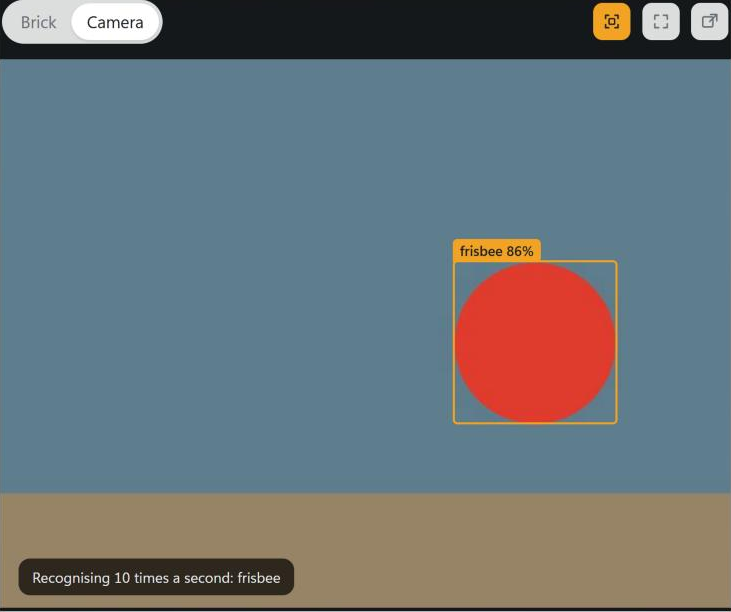

# Object recognition

The console can recognise everyday things in the robot camera's video: people, cups, bottles, chairs, balls, pets and about 70 more. It draws a box and a name around each one, live, while you drive.



```
Pi camera ──WiFi──▶ console on the laptop ──▶ browser: video
                      │
                      └─ pc/vision.py: newest frame ──▶ model (YOLOX-nano) ──▶ boxes and names ──▶ browser
```

- **Where it runs:** on the laptop, not the Pi. A Pi 3 manages 2–4 pictures a second, while a laptop manages 10, with time to spare.
- **What it costs:** recognition runs only while the Camera view is on screen with recognition turned on, and stops a few seconds after you leave. It uses two CPU threads at most, so driving stays smooth.
- **Privacy:** everything stays on the laptop. Nothing is uploaded, and the only internet access is the one-time model download.
- **Safety:** recognition only shows what it sees. It never moves the motors.

## You need

| | What | Why |
|---|---|---|
| Python | **3.10 or newer** | onnxruntime has no packages for 3.9 |
| Packages | `numpy`, `onnxruntime`, `pillow` (in [`pc/requirements-vision.txt`](../pc/requirements-vision.txt)) | numbers, running the model, reading JPEG pictures |
| Model | `pc/models/yolox_nano.onnx`, 3.7 MB | the trained network that recognises things |
| Camera | the Raspberry Pi camera from [CAMERA.md](CAMERA.md), working in the console | the pictures to look at |

This is the only part of PowerShock that needs anything beyond the Python standard library. Without it, everything else works as before.

## Set it up (once)

In PowerShell, in the PowerShock folder:

1. **Install the packages** (about 30 MB to download):
   ```powershell
   python -m pip install -r pc\requirements-vision.txt
   ```
2. **Get the model:**
   ```powershell
   python pc\tools\get_model.py
   ```
   It downloads `yolox_nano.onnx` from the official YOLOX releases on GitHub and checks its SHA-256 checksum before keeping it. A changed or broken download is refused and deleted.
3. **Check it:**
   ```powershell
   python pc\tools\get_model.py --check
   ```
   It should say `yolox_nano.onnx is there and its checksum is right.`

There's no need to restart the console: it notices the packages and the model the next time you turn recognition on.

## Use it

1. Open the **Robot** page and switch the 3D view to **Camera**.
2. Click the **Recognise objects** button (the square in a frame, next to full screen), or press **R**.
3. Boxes and names appear on the video. The line at the bottom says how many times a second it's recognising, and what it sees.

Click the button or press **R** again to turn it off. The console remembers your choice. **R** also works in full screen.

## What to expect

- **What it knows:** 80 kinds of thing, from the COCO set: people, animals (cat, dog, bird, horse…), vehicles, furniture (chair, sofa, table, bed), kitchen things (cup, bottle, bowl, fork…), electronics (TV, laptop, phone, keyboard), and toys and sport (ball, teddy bear, kite…). It doesn't know LEGO bricks, walls or doors.
- **How sure it is:** only things it's at least 40% sure of are shown, with the percentage.
- **Speed:** about 15 ms a picture on a typical laptop, capped at 10 pictures a second.
- **Delay:** each box comes from a picture 0.1–0.3 s old, so it trails slightly behind fast movement.
- **Small and far things** are found less often: the model looks at the picture at 416 × 416.
- **Blur:** fast turning blurs the picture, and blurred things aren't recognised. Drive slower, or add light.

## Where things are

| File | What it is | In git? |
|---|---|---|
| `pc/vision.py` | reads frames from the camera, runs the model, keeps the newest result | yes |
| `pc/tools/get_model.py` | downloads and checks the model | yes |
| `pc/requirements-vision.txt` | the three packages | yes |
| `pc/models/yolox_nano.onnx` | the model | **no**: `pc/models/` is ignored |

The model's address, size and checksum are fixed in `pc/vision.py` (`MODEL_URL`, `MODEL_SIZE`, `MODEL_SHA256`).

## The model and its licence

- **Model:** [YOLOX](https://github.com/Megvii-BaseDetection/YOLOX)-nano, by Megvii, trained on the COCO dataset.
- **Licence:** Apache-2.0.
- **Why it isn't in this repository:** it's a binary file with its own licence, so each person downloads it from its source.
- **Checksum (SHA-256):** `c789161ed43c8269fcd4e67c67eeeb4e80c622da2eb296a20bc6007bd18a0b7d`.

**Without the tool:**

1. Download `yolox_nano.onnx` yourself, from the YOLOX GitHub releases (version 0.1.1rc0).
2. Put it in `pc\models\`.
3. Run `python pc\tools\get_model.py --check`. A file with a different checksum isn't used.

## When something's wrong

| What you see | What to do |
|---|---|
| "Object recognition needs a one-time setup on this laptop" | Run the two setup commands above. The message lists only what's missing. |
| `pip` can't find `onnxruntime` | Your Python is too old, or 32-bit. Install 64-bit Python 3.10 or newer from python.org, then install the packages again. |
| "The model file isn't the one PowerShock expects" | The file is damaged or a different version. Run `python pc\tools\get_model.py` again. |
| `get_model.py` says it couldn't get the model | Check the internet connection. A company network may block GitHub downloads; then download it by hand as above. |
| "Too many camera views are open" | Close the camera's own window, or another console tab: recognition needs one of the 3 video connections. |
| Boxes are missing or flicker | The picture is blurred or dark, or the thing is small or far away. Slow down, add light, or move closer. |
| Driving feels slow while recognising | Unlikely, as it's capped at 10 a second and 2 threads. If it happens, close other heavy programs, or turn recognition off while driving. |

## Removing it

1. Delete the `pc\models` folder.
2. Optionally, uninstall the packages:
   ```powershell
   python -m pip uninstall onnxruntime
   ```
   numpy and Pillow are often used by other programs, so keep them unless you know they aren't.
